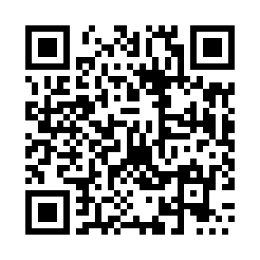

# pzsolve

[](https://github.com/boulayo/bitcoin-puzzle-solver/actions/workflows/ci.yml)

pzsolve is a solver for the **Bitcoin Puzzle**, the series of 160 addresses where private key *n* lies in `[2^(n-1), 2^n - 1]`, written in C.
It brings together the three methods that make sense for it (a linear scan of the range, baby-step giant-step with a table in RAM, and
Pollard's kangaroo), picks the one that fits what you know about the target, and runs it on the CPU with SIMD code (AVX2, AVX-512) and on
GPUs through CUDA and OpenCL.

It measures your machine the first time and chooses the best mix of CPU threads, SIMD engine and GPUs by itself. Every engine and every GPU
is checked bit by bit against a reference before it is used, and every candidate key is re-verified. Campaigns resume after any
interruption and can be shared among several computers. The kangaroo needs about 1.06·√W steps on the real curve (measured), against
1.15·√W published for RCKangaroo.

Italian documentation: [docs/it/](docs/it/README.md). Free software: if it is useful to you, you can [support the project](#support-the-project).

> **Honest numbers.** The program is correct and fast, but the puzzles that are still open are computationally enormous.
> `pzsolve puzzle 71` shows how long a search would take *on your machine*: puzzle 71 needs about 6·10^20 keys on average, which
> is thousands of years even at billions of keys per second. No search order raises the chance of success per key scanned; the
> campaign order only keeps you from overlapping with people who scan sequentially and makes a campaign reproducible and resumable.

## What it does

| What you know | Algorithm | Average cost |
|---|---|---|
| only the **address** | linear scan: batch inversion with the ± symmetry, SIMD curve arithmetic, SIMD/GPU hash160 | ½ · 2^(n-1) keys |
| the **public key** too, and the table fits in RAM (no GPU) | **symmetric BSGS with a RAM table** (reusable from SSD) | **≈ 1.0 · √W** steps (W = 2^(n-1)), deterministic |
| the **public key** too, table too large or GPU available | symmetric Pollard kangaroo ("schema 3") | ≈ 1.06 · √W steps measured, ≈ 1.02 expected at puzzle scale (model) |

`--mode auto` (the default) chooses for you. A "step" is one kangaroo jump or one BSGS giant step; a "key" is one candidate key of the
linear scan. The algorithms are explained in [`docs/en/ALGORITHMS.md`](docs/en/ALGORITHMS.md).

* **All puzzles are built in.** `pzsolve puzzles` lists them and `pzsolve hunt -p N` starts a campaign; range, address and public
  key come from a database checked against an independent Python reference (puzzles 161-256 included). Running the same command again
  **resumes** the campaign. `pzsolve list` shows progress, speed and time left.
* **One visiting order per campaign.** A random 256-bit seed (reusable with `--seed`) drives a bijective pseudo-random permutation of
  blocks: nothing is skipped or repeated, and inside a block the scan is sequential.
* **Fast linear scan.** Montgomery batch inversion, SIMD curve arithmetic (AVX2, AVX-512, AVX-512 IFMA) and SIMD/GPU hash160. The engine
  is chosen at run time by a micro-benchmark, after a check against a known key.
* **BSGS in RAM.** A baby-step table that does not depend on the target and can be saved to SSD (`--table`).
* **Kangaroo.** Equivalence classes `{P, -P}`, distinguished points in a RAM table, an append-only log on disk, detection of
  unproductive cycles.
* **GPU: CUDA and OpenCL.** CUDA uses the driver that comes with the normal NVIDIA driver (no toolkit needed); OpenCL covers AMD and
  Intel. At start-up every GPU must pass a **bit-exact self-test against the CPU**, and every candidate key is re-verified on the CPU.
* **Several computers.** Linear scan: `--part Q/T` (same seed) splits the work with no communication, and `pzsolve split` divides it in
  proportion to speed. Kangaroo: `--node N` and `pzsolve merge` combine the distinguished points.
* **Use only part of the machine.** `--limit X` uses X % of the CPU threads and of the GPU work-items at full speed, without pauses.
* **Persistent campaigns.** Atomic checkpoints, resume after Ctrl-C, crash, reboot or sleep, and a lock against two processes on the
  same campaign. `--keep-awake` prevents sleep on Windows and macOS.
* **Self-tuning.** The first `hunt` of each version measures the best mix of CPU threads and GPUs (about 2 minutes, then remembered).
  Override with `-t` and `--gpu`, measure again with `--retune`, skip with `--no-tune`. `pzsolve bench --together` measures the
  combination and `pzsolve doctor` checks the program, the machine and the campaigns.
* **Live panel and files.** A panel updated once per second shows speed per device, time left and success probability. The campaign
  folder holds `report.txt`, `status.json`, `stats.csv`, `log.txt` and, when the key is found, `FOUND.txt` (permissions 0600).

## Quick start

Download the archive for your platform from the [Releases page](../../releases), unpack it and check it with `SHA256SUMS`. Nothing needs
to be installed; for NVIDIA GPUs the normal graphics driver is enough (version 525 or later).

```sh
./pzsolve devices          # detected hardware
./pzsolve selftest         # correctness checks, GPUs included
./pzsolve puzzle 71        # interval and estimated time on this machine
./pzsolve hunt -p 71       # start; Ctrl-C stops, the same command resumes
./pzsolve list             # progress of all campaigns
./pzsolve hunt -p 40       # test run on a solved puzzle: finds the key within seconds
```

On Windows use `.\pzsolve.exe` in PowerShell. Campaigns are stored in a `campaigns` folder where you run the command. The first
start with an NVIDIA GPU takes about a minute longer, while the driver compiles the kernels.

For a target that is not in the database use `-a ADDRESS` and/or `-k PUBLIC_KEY` (compressed or uncompressed hex) and optionally
`-r START:END` (hex). Several computers on the linear scan use the same seed and range and a different share each:

```sh
./pzsolve hunt -p 71 -s <64-hex-digit seed> --part 0/2     # computer A
./pzsolve hunt -p 71 -s <64-hex-digit seed> --part 1/2     # computer B
./pzsolve hunt -p 71 --limit 50                            # use half of this machine
```

`pzsolve hunt --help` lists every option; the full guide is [`docs/en/USAGE.md`](docs/en/USAGE.md).

## Supported platforms

| Platform | CPU code | GPU |
|---|---|---|
| Linux x86-64, Windows x86-64 (10/11, static exe) | portable, AVX2, AVX-512, AVX-512 IFMA (chosen at run time) | NVIDIA through CUDA, others through OpenCL |
| Linux arm64 | portable code, plus NEON engines with the hardware SHA-256 of the CPU | whatever the CUDA/OpenCL drivers offer |
| macOS arm64 (Apple silicon) | portable code, plus NEON engines with the hardware SHA-256 | none: CPU only |
| macOS Intel | portable code only | none: CPU only |

On arm64 only the hash stage of the linear scan uses NEON and the CPU's SHA-256 instructions; the curve arithmetic, the kangaroo and BSGS
run portable code, which is much slower than the x86-64 SIMD engines. Use these builds to try the program, run the tests or search small
puzzles. The Linux x86-64 binary needs glibc 2.34 or later (Ubuntu 22.04+, Debian 12+).

On macOS a browser download is quarantined and the binary is not notarized: run `xattr -dr com.apple.quarantine <folder>` once, or
build from source. On Windows, SmartScreen may ask for "More info" and "Run anyway".

## How it compares

Cost in steps, in units of √W, where W is the interval size. This compares steps only: it says nothing about raw speed, which depends
on hardware and kernel quality. Run `pzsolve bench` to measure yours, and please share comparisons with other tools in the Issues.

| Method | Average cost | Status |
|---|---|---|
| classic Pollard kangaroo (van Oorschot-Wiener) | ≈ 2·√W | literature |
| symmetric kangaroo with ± classes (Galbraith-Ruprai) | ≈ 1.36·√W | theory |
| RCKangaroo | 1.15·√W | the figure published by its author |
| pzsolve, schema 3 | 1.06·√W | measured, W = 2^32 to 2^44, real curve |
| pzsolve, schema 3, at puzzle scale | ≈ 1.02·√W | modelled, not measured |
| BSGS with ± and a table of √W/2 entries | 1.0·√W | needs a table that fits in RAM: not feasible for the open puzzles |

The full tables and the model are in [`docs/en/ALGORITHMS.md`](docs/en/ALGORITHMS.md) (sections 8.8 and 8.10) and, for the measurements behind them,
in [`docs/en/RESEARCH.md`](docs/en/RESEARCH.md) (same sections).

## Limits and what to expect

| Puzzle | Known | Average work | Assumed speed | Time |
|---|---|---|---|---|
| 71 | address only | 5.9·10^20 keys | 1 G keys/s | 50 % in 18,700 years |
| 71 | address only | 5.9·10^20 keys | 10 G keys/s | 50 % in 1,870 years |
| 140 | public key | 8.8·10^20 steps | 1 G steps/s | median 26,300 years |
| 160 | public key | 9.1·10^23 steps | 1 G steps/s | median 27 million years |

* **Collaboration is needed.** Speeds add up across computers, but the open puzzles are many orders of magnitude beyond one machine.
  Puzzle 135, now solved, reportedly took about 300 GPUs for 5 months (a reported figure, not verified here).
* **This is a research and educational tool.** There is no guarantee of finding anything. The "solved / open" state comes from the
  date the database was created: check on a blockchain explorer that the funds are still there before a long campaign.
* Only addresses of a **compressed** public key are supported: P2PKH (`1...`) and native SegWit P2WPKH (`bc1q...`).
* The kangaroo is probabilistic and its cost has a long tail. GPU speeds were measured on one NVIDIA card (CUDA) and one Intel
  integrated GPU (OpenCL); the kangaroo on the GPU is limited by memory bandwidth, and AMD cards are untested for speed.

## Building from source

Requirements: `gcc` 9 or later (or `clang`) and `make`. No GPU SDK is needed to compile.

```sh
make            # builds build/pzsolve
make test       # unit tests + built-in selftest
make e2e        # end-to-end tests on small puzzles (about 5 minutes)
make windows    # build/win/pzsolve.exe, cross-compiled with MinGW-w64
```

`tools/verify.sh` runs the full battery: AddressSanitizer, UndefinedBehaviorSanitizer, ThreadSanitizer, Valgrind, a re-check of the puzzle
database, and the Windows exe under Wine. The GPU kernels are tested bit by bit against the CPU on pocl (OpenCL on the CPU) and, for
CUDA, with a simulated driver. The macOS and arm64 builds are built and tested by the CI on every push.

## Documentation

* [`docs/en/USAGE.md`](docs/en/USAGE.md): commands, all options, the campaign folder, GPUs, several computers, troubleshooting, Windows.
* [`docs/en/ALGORITHMS.md`](docs/en/ALGORITHMS.md): the algorithms, the running times and the theoretical limits.
* [`docs/en/RESEARCH.md`](docs/en/RESEARCH.md): the research log, what was tried and what was measured (variants that were discarded, intermediate measurements).
* [`docs/en/ARCHITECTURE.md`](docs/en/ARCHITECTURE.md): how the source is organized.
* [`docs/en/RELEASING.md`](docs/en/RELEASING.md): versioning and the release procedure.
* [`CHANGELOG.md`](CHANGELOG.md) and [`tools/README.md`](tools/README.md): what changed, and the helper tools.

## Responsible use

pzsolve is meant for the public Bitcoin puzzle transaction and for other keys you are entitled to search. Do not use it against
wallets that are not yours. The author takes no responsibility for how the program is used.

## Support the project

pzsolve is free and developed in spare time. If it saved you time or taught you something, a donation is appreciated and never expected.

| **Bitcoin (on-chain)** | **Bitcoin (Lightning address)** |
|:---:|:---:|
|  |  |
| `bc1qfw2y5xzvsy6w70rwqfq6n65tahk906678c7tvz` | `trivialalarm90@cake.cash` |

Scan a code with your wallet, or copy the text. The only official place for these addresses is this README in the official repository:
be wary of copies elsewhere.

## License

pzsolve is free software, licensed under the **GNU Affero General Public License, version 3 or later** (`AGPL-3.0-or-later`, see
[LICENSE](LICENSE)). You may use, study, modify and share it. If you distribute a modified version, or let users interact with one over
a network, you must offer them the complete corresponding source code under the same license.

**Commercial license.** If you want to use pzsolve in a proprietary product or service without the obligations of the AGPL, a paid
commercial license is available. Open an issue titled "Commercial license" (without confidential details) or write to leonardo@boulayo.it. Contributions are welcome under [CONTRIBUTING.md](CONTRIBUTING.md).

Copyright (C) 2026 Leonardo Boulay.
